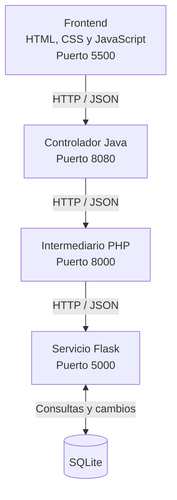

# Sistema de Gestión de Monitores Académicos

**Universidad de Caldas · Arquitectura de Software**

Proyecto desarrollado para gestionar los monitores académicos y las materias a las que están vinculados. Desde la interfaz se pueden consultar, registrar, buscar, editar y eliminar monitores. Para el taller, dividimos el funcionamiento entre varias tecnologías que se comunican mediante HTTP y JSON.

---

## Contenido

- [1. ¿Qué permite hacer el sistema?](#1-qué-permite-hacer-el-sistema)
- [2. Tecnologías y arquitectura](#2-tecnologías-y-arquitectura)
- [3. Estructura del proyecto](#3-estructura-del-proyecto)
- [4. Requisitos para ejecutarlo](#4-requisitos-para-ejecutarlo)
- [5. Cómo ejecutar el proyecto](#5-cómo-ejecutar-el-proyecto)
- [6. Endpoints de la API](#6-endpoints-de-la-api)
- [7. Pruebas realizadas](#7-pruebas-realizadas)
- [8. Diagrama de secuencia](#8-diagrama-de-secuencia)
- [9. Problemas resueltos durante la integración](#9-problemas-resueltos-durante-la-integración)
- [10. Estado final](#10-estado-final)

---

## 1. ¿Qué permite hacer el sistema?

En la página principal se puede:

- Consultar las materias disponibles.
- Ver la lista de monitores registrados.
- Buscar un monitor utilizando su código.
- Registrar un monitor con su nombre, correo y materia.
- Modificar los datos de un monitor existente.
- Eliminar un monitor, previa confirmación.
- Ver mensajes cuando falta información, el código ya existe o no se encuentra un registro.

## 2. Tecnologías y arquitectura

### 2.1. Componentes

| Capa | Tecnología | Puerto | Función |
|---|---|---:|---|
| Interfaz web | HTML, CSS y JavaScript | `5500` | Formularios, consultas y visualización de resultados. |
| Controlador | Java y Spring Boot | `8080` | Recibe las solicitudes del navegador, valida y se comunica con PHP. |
| Intermediario | PHP y cURL | `8000` | Reenvía las peticiones a Python y devuelve sus respuestas. |
| Servicio de datos | Python y Flask | `5000` | Ejecuta las operaciones sobre los monitores y materias. |
| Base de datos | SQLite | — | Almacena los registros. |

### 2.2. ¿Cómo se comunican?



El navegador **solo hace peticiones al controlador Java**. Java se conecta con PHP; PHP se comunica con Python, y Python es el que trabaja directamente con SQLite.

## 3. Estructura del proyecto

```text
gestion-monitores/
├── db/                  # Esquema de la base de datos
├── frontend/            # Interfaz HTML, CSS y JavaScript
├── java-controller/     # Controlador Java y diagrama de secuencia
├── php-broker/          # Servicio intermediario PHP
├── postman/             # Colección de pruebas automatizadas
├── python-service/      # API Flask y acceso a SQLite
└── Readme.md            # Instrucciones del proyecto
```

## 4. Requisitos para ejecutarlo

Antes de iniciar, se necesita tener instalado:

- **Python 3** y `pip`.
- **PHP 8 o superior**, con la extensión **cURL** habilitada (por ejemplo, desde XAMPP).
- **JDK 17** para el controlador Java.
- Un navegador web.
- **Postman**, si se quiere repetir las pruebas automáticas.

El controlador incluye el wrapper de Gradle (`gradlew.bat`), por lo que no hace falta instalar Gradle de forma global.

> **Importante:** los comandos siguientes están pensados para **Windows PowerShell**. Abre una terminal independiente para cada servidor y mantenlas abiertas mientras utilizas la aplicación.

## 5. Cómo ejecutar el proyecto

Los servidores deben iniciarse desde la carpeta principal del repositorio, en este orden: **Python → PHP → Java → frontend**.

### 5.1. Iniciar Python y SQLite

**Terminal 1:**

```powershell
cd python-service
python -m venv .venv
.\.venv\Scripts\Activate.ps1
pip install -r requirements.txt
python app.py
```

El servicio debe quedar disponible en `http://localhost:5000`.

> Si ya tienes un entorno virtual configurado, actívalo y omite la creación de uno nuevo.

### 5.2. Iniciar el intermediario PHP

**Terminal 2:**

```powershell
cd php-broker
php -S localhost:8000 router.php
```

Si utilizas XAMPP y `php` no aparece como comando reconocido:

```powershell
cd php-broker
& "C:\xampp\php\php.exe" -S localhost:8000 router.php
```

**Ejecuta este comando dentro de `php-broker`.** Si lo haces desde otra carpeta, PHP podría no encontrar `router.php`.

#### Comprobar PHP

En otra terminal, desde cualquier directorio:

```powershell
curl.exe -i http://localhost:8000/api/materias
```

Si Python y PHP están bien iniciados, la consulta debe responder con datos JSON y el estado HTTP `200`.

### 5.3. Iniciar el controlador Java

**Terminal 3:**

```powershell
cd java-controller
.\gradlew.bat bootRun
```

Java utiliza el puerto `8080` y necesita poder conectarse al servicio PHP del puerto `8000`.

#### Configuración de la dirección de PHP

El archivo de configuración está en:

`java-controller/src/main/resources/application.properties`

En la integración local tuvimos un inconveniente porque PHP escuchaba por IPv6 y Java intentaba conectarse por IPv4. Si se presenta nuevamente un error de conexión (`502`), revisa primero cómo está escuchando PHP y la dirección configurada en Java.

Si tu versión de `application.properties` utiliza la variable de entorno `PHP_SERVICE_URL`, puedes definirla **antes de ejecutar Java**:

```powershell
$env:PHP_SERVICE_URL = "http://[::1]:8000"
.\gradlew.bat bootRun
```

En cambio, si el archivo contiene una URL fija (`php.service.url=...`), debes ajustarla allí o configurar ambos servicios para que utilicen la misma dirección. La dirección `[::1]` fue la que funcionó en el entorno donde hicimos las pruebas.

#### Comprobar Java

```powershell
curl.exe -i http://localhost:8080/api/materias
```

La respuesta correcta es `HTTP 200` con el listado de materias.

### 5.4. Iniciar el frontend

**Terminal 4:**

```powershell
cd frontend
python -m http.server 5500
```

Abre el navegador en:

**http://localhost:5500**

Desde allí puedes utilizar los formularios, la tabla de monitores y las opciones de búsqueda, edición y eliminación. El frontend se comunica con `http://localhost:8080/api`.

## 6. Endpoints de la API

Las solicitudes del frontend llegan al controlador Java mediante estas rutas:

| Método | Ruta | ¿Qué hace? |
|---|---|---|
| `GET` | `/api/materias` | Consulta las 8 materias iniciales. |
| `GET` | `/api/monitores` | Lista todos los monitores. |
| `GET` | `/api/monitores/{codigo}` | Busca un monitor por código. |
| `POST` | `/api/monitores` | Registra un monitor. |
| `PUT` | `/api/monitores/{codigo}` | Actualiza un monitor. |
| `DELETE` | `/api/monitores/{codigo}` | Elimina un monitor. |

### 6.1. Ejemplo de registro

**Petición:** `POST http://localhost:8080/api/monitores`

```json
{
  "codigo": "202699",
  "nombre_completo": "Monitor de Prueba",
  "correo": "monitor.prueba@ejemplo.com",
  "materia_id": 1
}
```

El código del ejemplo es temporal: conviene comprobar que no exista antes de enviarlo.

### 6.2. Respuestas HTTP utilizadas

| Código | Significado dentro del sistema |
|---|---|
| `200` | Consulta, actualización o eliminación exitosa. |
| `201` | Monitor registrado correctamente. |
| `400` | Faltan datos o la información enviada no es válida. |
| `404` | No se encontró el registro solicitado. |
| `405` | Método HTTP no permitido. |
| `409` | Ya existe un monitor con ese código. |

## 7. Pruebas realizadas

Probamos la API con Postman y también utilizamos la aplicación desde el navegador para comprobar las operaciones del formulario y la tabla.

### 7.1. Colección de Postman

Archivo: [`postman/Gestion_Monitores_QA.postman_collection.json`](postman/Gestion_Monitores_QA.postman_collection.json)

Para repetir las pruebas:

1. Abre Postman e importa la colección.
2. En las variables de la colección, define `base_url` con `http://localhost:8000` para probar PHP o `http://localhost:8080` para probar Java.
3. Utiliza `codigo_prueba` con el valor `202699` (o cualquier código temporal que no exista).
4. Ejecuta las carpetas de consultas y validaciones; luego ejecuta la carpeta CRUD **en el orden establecido**.

### 7.2. Resultados obtenidos

| Grupo de pruebas | Contra PHP | Contra Java |
|---|---:|---:|
| Consultas sin modificar datos | 15/15 | 15/15 |
| Validaciones de errores | 6/6 | 6/6 |
| CRUD secuencial | 18/18 | 18/18 |
| **Total** | **39/39** | **39/39** |

**Resultado conjunto: 78 validaciones aprobadas y 0 fallidas** en las dos ejecuciones de la colección que realizamos durante la integración.

### 7.3. Prueba desde la interfaz

También comprobamos manualmente desde el navegador:

- Carga de materias y listado de monitores.
- Registro de un monitor.
- Búsqueda por código.
- Edición de información.
- Eliminación de un registro.
- Visualización de mensajes de respuesta.

Estas comprobaciones se hicieron con los cuatro servidores en ejecución.

## 8. Diagrama de secuencia

El equipo documentó el caso **RF1: registro de un monitor**, incluyendo los posibles errores de validación y de código duplicado.

Puedes consultar el diagrama y la explicación de cada capa aquí:

**[Ver diagrama de secuencia del controlador Java](java-controller/docs/entregable-2-diagrama-secuencia.md)**

El diagrama muestra el recorrido de la petición desde el usuario hasta la base de datos y el regreso de la respuesta HTTP.

## 9. Problemas resueltos durante la integración

Durante las pruebas encontramos algunos detalles que tuvimos que corregir:

- **Java y Jackson:** agregamos la dependencia necesaria para el manejo del JSON en el controlador.
- **Pruebas de Spring Boot:** corregimos la importación de `AutoConfigureMockMvc` para que las pruebas pudieran ejecutarse.
- **Conexión Java–PHP:** comprobamos un problema de dirección IPv4/IPv6 y ajustamos la configuración local.
- **Servidor PHP:** verificamos que debía iniciarse dentro de `php-broker` para encontrar `router.php`.
- **Pruebas CRUD:** utilizamos un código temporal para no alterar los monitores que venían cargados en la base de datos.

Después de esas correcciones repetimos las pruebas de integración, con resultados satisfactorios.

## 10. Estado final

El sistema quedó integrado y se probó el recorrido **frontend → Java → PHP → Python → SQLite**. Además de las pruebas automáticas, revisamos las funciones principales desde el navegador.

Para ejecutarlo en otro computador, lo más importante es instalar las herramientas necesarias, iniciar los servicios en el orden indicado y comprobar que los puertos y las direcciones de conexión coincidan.

---

**Universidad de Caldas · Arquitectura de Software · Sistema de Gestión de Monitores Académicos**
