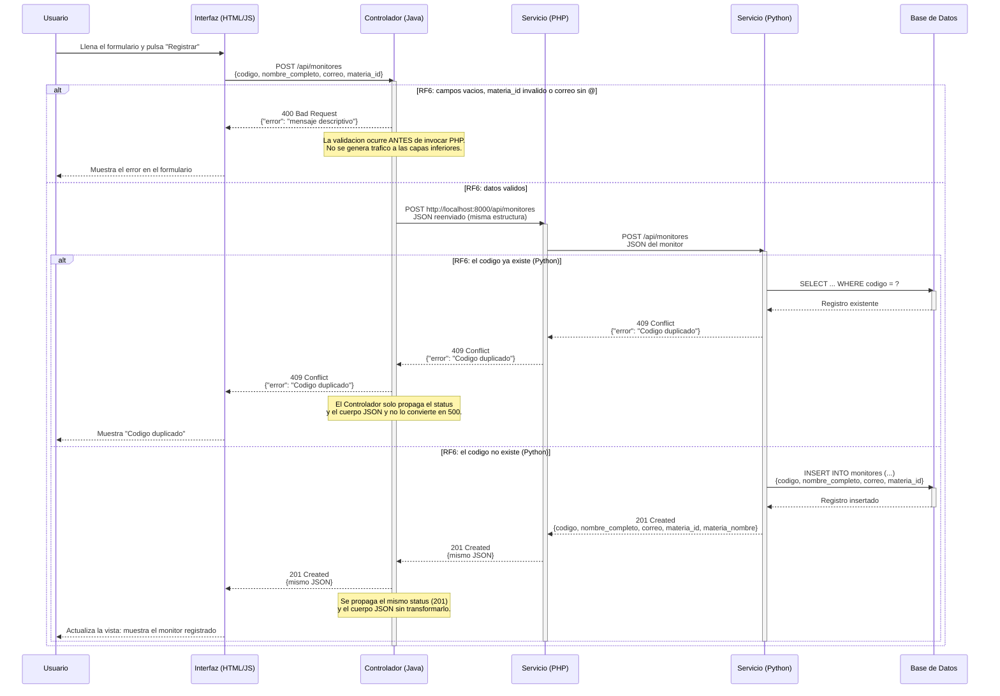

# Entregable 2 — Diagrama de secuencia: Registro de un monitor (RF1)

> Componente: **Controlador (Java)** — Spring Boot 3, Java 17
> Ruta modelada: `POST /api/monitores`
> Referencia de código: `src/main/java/com/ucaldas/monitores_controller/controller/MonitorController.java`

## Diagrama de secuencia

## Responsabilidad de cada capa en el flujo

| Capa | Responsabilidad durante el registro (RF1 + RF6) |
|---|---|
| **Usuario** | Digita los datos del monitor en el formulario y dispara el registro; recibe el resultado (éxito o mensaje de error). |
| **Interfaz (HTML/JS)** | Construye el JSON de la petición (`{"codigo","nombre_completo","correo","materia_id"}`), envía `POST /api/monitores` al Controlador (puerto 8080) y refleja en pantalla el `status` y el `{"error": ...}` o el monitor creado. |
| **Controlador (Java)** | Expone `POST /api/monitores`, aplica la validación RF6 en memoria (campos vacíos, `correo` con `@`, `materia_id > 0`) y, si falla, responde `400` **sin llamar a PHP**. Si es válido, reenvía la petición por HTTP (`HttpClient`) al intermediario PHP y propaga tal cual el `status` y el cuerpo JSON (incluidos `409` y `201`). No toca Python ni la base de datos. |
| **Servicio (PHP)** | Intermediario: recibe la petición del Controlador, la enruta a la capa de persistencia (Python) y devuelve el mismo `status` y JSON, sin alterar la respuesta. |
| **Servicio (Python)** | Capa de persistencia: consulta la existencia del `codigo`; si existe responde `409 Conflict` con `{"error": "Código duplicado"}`, si no existe inserta el registro y responde `201 Created` con el monitor completo (incluido `materia_nombre`). |
| **Base de Datos** | Ejecuta la consulta `SELECT` por `codigo` y el `INSERT` del nuevo monitor; devuelve el resultado a Python. |
